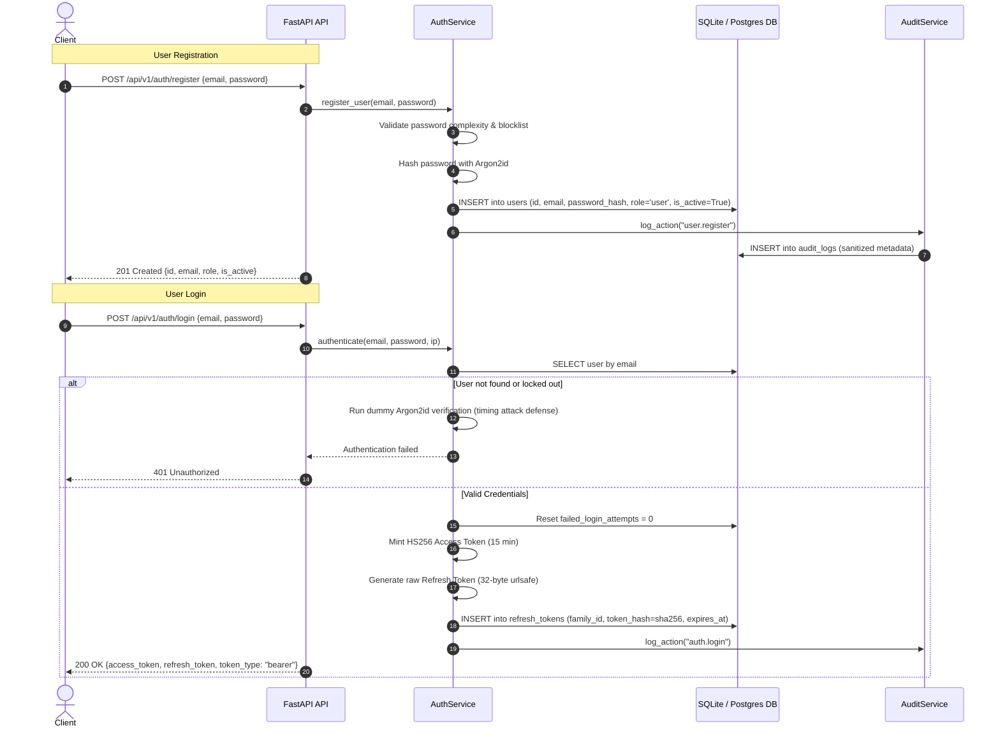
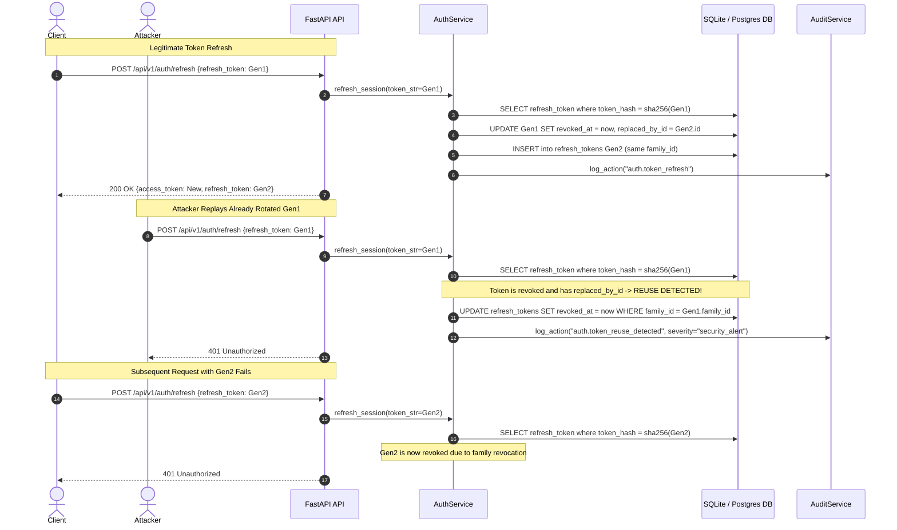
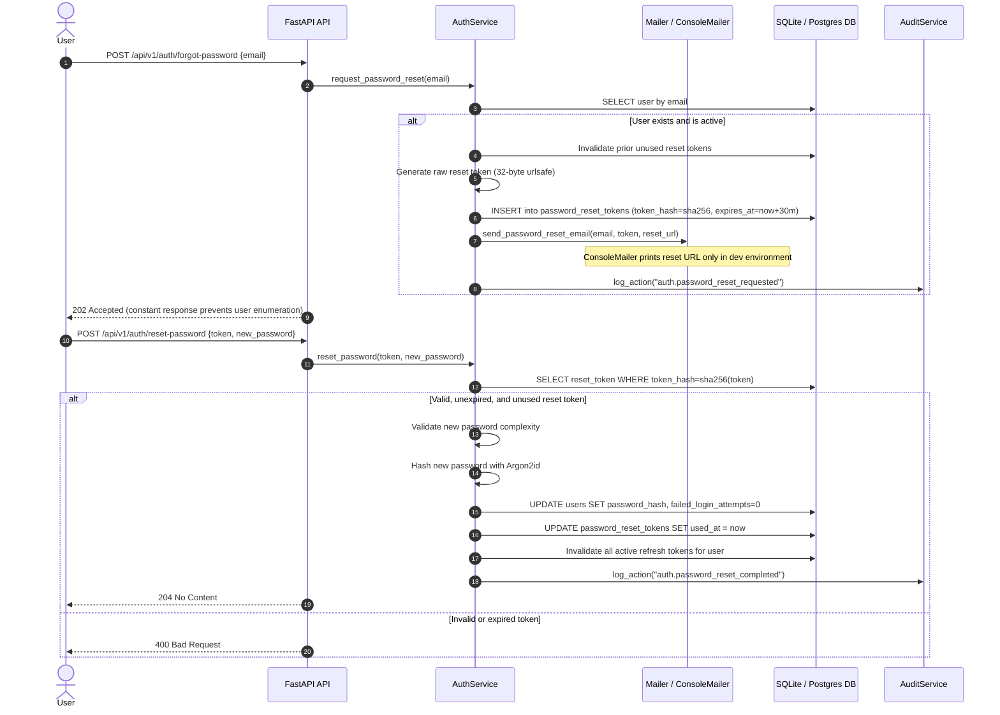
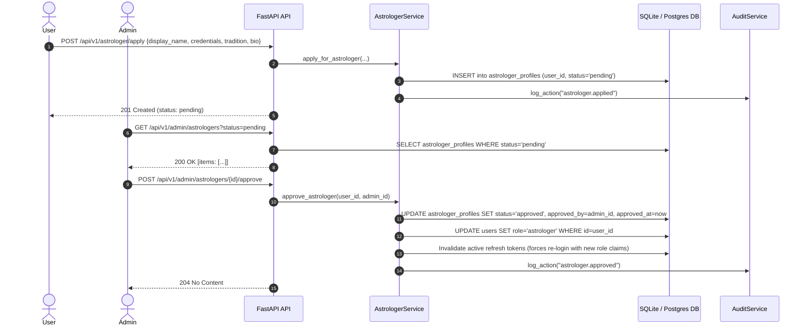

# Authentication, Authorization, and Session Management Architecture

This document describes the design, threat mitigation, token lifecycle, role-based access control (RBAC), data visibility policies, and planned limitations for the Kundali authentication and authorization system.

---

## 1. System Overview

The authentication and authorization layer provides secure identity verification, session lifecycle management, and role-based permissions for users, credentialed astrologers, and system administrators.

Key characteristics:
- **Password Hashing**: Argon2id with production parameters (`time_cost=3`, `memory_cost=65536` KiB, `parallelism=4`).
- **Access Tokens**: Short-lived (15 minutes), stateless HMAC-SHA256 (HS256) JWTs containing subject UUID and role.
- **Refresh Tokens**: Rotating, high-entropy 32-byte tokens (7-day validity). Token families track rotation chains. Raw tokens are sent only once in the response body; only SHA-256 digests are stored in the database.
- **Token Family Reuse Detection**: If an already-rotated refresh token is presented again (indicating potential token theft or replay), the entire token family is immediately revoked.
- **Rate Limiting & Lockout**: Account-level lockout for 15 minutes after 5 consecutive failed login attempts; sliding-window rate limiting on sensitive authentication endpoints.
- **Audit Logging**: Structured audit records persisted to the database with IP tracking and automatic sanitization of sensitive values (passwords, tokens, credentials).

---

## 2. Sequence Diagrams

### 2.1 User Registration and Login

### 2.2 Token Rotation and Family Revocation on Reuse

### 2.3 Password Reset Workflow

### 2.4 Astrologer Application and Review Workflow

---

## 3. Token Lifecycle Table

| Token Type | Lifetime | Storage Location | Cryptographic Protection | Payload / Format | Revocation Mechanism |
| :--- | :--- | :--- | :--- | :--- | :--- |
| **Access Token** | 15 minutes | In-memory client side (never stored in DB) | HMAC-SHA256 (HS256) signed with `JWT_SECRET` (min 32 chars) | JSON Web Token (JWT) with `sub` (User UUID), `role`, `iat`, `exp` | Short TTL (15 min); expires naturally |
| **Refresh Token** | 7 days | Client receives raw string in body; DB stores SHA-256 hash | High-entropy 32-byte URL-safe string; DB stores SHA-256 hex digest | Opaque token string | Immediate revocation on rotation (`replaced_by_id`), logout, logout-all, password reset, or family revocation on reuse |
| **Password Reset Token** | 30 minutes | Client receives raw string via reset link; DB stores SHA-256 hash | High-entropy 32-byte URL-safe string; DB stores SHA-256 hex digest | Opaque token string | Single-use flag (`used_at`); immediate invalidation upon password reset or issuance of a new token |

---

## 4. Role x Permission Matrix

All 12 permissions required by the system specification are enforced across roles:

| Permission | Description | `user` | `astrologer` | `admin` |
| :--- | :--- | :---: | :---: | :---: |
| `account:self` | Manage own account settings, view profile `/me` | Yes | Yes | Yes |
| `profile:manage_own` | Create and edit own birth profile data | Yes | Yes | Yes |
| `chart:read_own` | Compute and inspect own birth chart facts | Yes | Yes | Yes |
| `chat:use` | Query Vedic astrological AI assistant | Yes | Yes | Yes |
| `astrologer:apply` | Submit credentialing application to become an astrologer | Yes | Yes | Yes |
| `review:read_queue` | Read the chart review queue | No | Yes (approved only) | Yes |
| `review:decide` | Approve or reject astrological chart reviews | No | Yes (approved only) | Yes |
| `knowledge:author` | Contribute astrological interpretations / knowledge chunks | No | Yes (approved only) | Yes |
| `admin:astrologers_manage` | Review, approve, or suspend astrologer credentials | No | No | Yes |
| `admin:users_manage` | Deactivate or reactivate user accounts | No | No | Yes |
| `admin:audit_read` | Inspect paginated security and system audit logs | No | No | Yes |
| `admin:metrics_read` | View system operational metrics | No | No | Yes |

*Note: Astrologers inherit all standard user permissions in addition to review and knowledge authoring permissions. Administrators hold all system permissions.*

---

## 5. Data Visibility Policy

Strict visibility boundaries are defined to protect user privacy and astrological data integrity across feature boundaries (including features not yet built):

1. **User Visibility**:
   - Users have full access to their own account metadata, encrypted birth records, computed astrological facts, charts, and AI chat sessions.
   - Users cannot see other users' data under any circumstance.

2. **Astrologer Visibility**:
   - Credentialed astrologers conducting chart reviews see **only derived chart facts** (ascendant, planetary longitudes, house placements, dashas, yogas) and AI-generated chart summaries.
   - Astrologers **NEVER** see a user's name, email address, contact information, or raw birth details (exact time, date, or latitude/longitude coordinates).

3. **Administrator Visibility**:
   - System administrators have access to account metadata (email, role, account status, creation date, audit trail).
   - Administrators **NEVER** see decrypted birth data or sensitive astrological profiling records.

*This data-visibility policy is an authoritative architectural constraint that applies to all current and future endpoints.*

---

## 6. Threat Model and Security Mitigations

- **Timing Attacks**:
  - Constant-time string comparisons (`hmac.compare_digest`) for token hash matching.
  - Dummy Argon2id verification executed when an email does not exist during authentication, ensuring constant execution time regardless of account existence.
- **Brute-Force & Credential Stuffing**:
  - Account lockout after 5 consecutive failed login attempts within 15 minutes.
  - In-memory sliding-window rate limiting on `/api/v1/auth/login` (5 requests / minute per IP).
- **Token Theft & Replay**:
  - Rotating refresh tokens with strict family tracking (`family_id`).
  - Presentation of an already-used refresh token revokes all active tokens in the entire family immediately, neutralizing stolen tokens.
- **Privilege Escalation**:
  - Role-based authorization enforced using declarative dependency factories (`require_role`, `require_permission`).
  - Users cannot self-modify their role.
  - Astrologer approval requires administrator action.
  - Last active administrator cannot be deactivated.
  - Self-deactivation by administrators is blocked.
- **Log Leakage**:
  - Password fields, raw token strings, and secret credentials are automatically stripped and replaced with `"[REDACTED]"` before writing to `audit_logs` or system output.

---

## 7. Limitations and Future Work

The current authentication and authorization implementation provides a rigorous baseline, with the following intentional limitations and scheduled future enhancements:

1. **In-Memory Rate Limiter**: The current sliding-window rate limiter is stored in process memory. Distributed environments with multiple API replicas will require Redis-backed distributed rate limiting (e.g., via Redis sliding window or token bucket).
2. **No Email Provider Integration**: Email delivery utilizes a `Mailer` protocol with a `ConsoleMailer` implementation that outputs reset links only when `ENVIRONMENT == "dev"`. Production deployments will integrate a transactional email provider (such as Postmark, Resend, or AWS SES).
3. **No Multi-Factor Authentication (MFA)**: MFA (TOTP / WebAuthn) is not yet supported and is planned for high-privilege administrative accounts.
4. **No Email Verification Flow**: Accounts are currently active immediately upon registration; email verification flows prior to first login are planned.
5. **No CAPTCHA**: Registration and login endpoints currently rely on rate limiting and password complexity checks; CAPTCHA (e.g., Cloudflare Turnstile) may be introduced if bot abuse is detected.
6. **No Explicit Consent Record**: GDPR / privacy policy consent timestamps are not tracked in the current user schema and will be added during compliance enhancements.
7. **Refresh Token in Response Body**: Refresh tokens are returned in the JSON response body rather than HttpOnly cookies to support multi-client architectures (mobile clients, CLI tools, web SPAs).
8. **Stateless Access Tokens**: Access tokens are stateless JWTs and cannot be individually revoked before their 15-minute expiration; critical account deactivations or role downgrades take effect upon the next token refresh or after access token expiry.
9. **Pending Endpoints**: `DELETE /me` (GDPR right to erasure) and `GET /me/export` (data portability) are scheduled for subsequent privacy milestones.
10. **Granular Ownership Checks & Chat Rate Limiting**: Per-resource ownership enforcement (e.g., charts, profiles) and token-budget rate limiting for AI chat will be added alongside the respective chart and AI module implementations.
